# Robots, scenes and worlds in RI

Status: `ok` merged and working, `wip` in an open branch or not tested yet, `todo` pending.

Previews live in `Docs/media/robots/` and `Docs/media/scenes/` (960x540 JPG). Longer videos go on YouTube and the `Link` column points to them.

## Robots

Launch paths are relative to `CustomRobots/`. Every noise/sensor variant is a row in the `robots` table of `database/worlds.sql`, here they are grouped by physical platform.

### Simulated mobile robots

| Robot              | Status | Media&nbsp;&nbsp;&nbsp;&nbsp;&nbsp;&nbsp;&nbsp;&nbsp;&nbsp;&nbsp;&nbsp;&nbsp;&nbsp;&nbsp;&nbsp;&nbsp;&nbsp;&nbsp;&nbsp;&nbsp;&nbsp;&nbsp;&nbsp;&nbsp;&nbsp;&nbsp;&nbsp;&nbsp;&nbsp;&nbsp;&nbsp;&nbsp;&nbsp;&nbsp;&nbsp;&nbsp; | Link | Launch file                                                | Entity                   | Configs                                | Sensors                         | Actuators                       | Notes                              |
| ------------------ | :----: | :---: | ---- | ---------------------------------------------------------- | ------------------------ | -------------------------------------- | ------------------------------- | ------------------------------- | ---------------------------------- |
| F1 car             |   ok   | 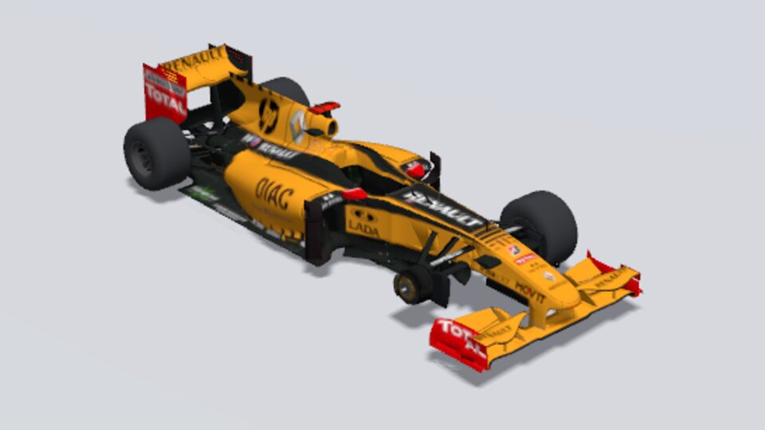 | [YouTube](https://www.youtube.com/watch?v=HRZC1-tGW-s) | f1/launch/f1.launch.py                                     | f1                       | mode=(holo/ackermann) sensor=(camera/laser/none) color | camera, laser or none | ackermann or holonomic steering |                                    |
| Autonomous car     |   ok   | 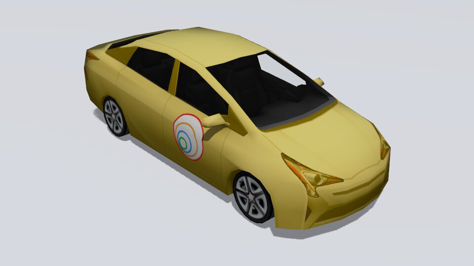 | [YouTube](https://www.youtube.com/watch?v=vQbbNEC_Dc8) | autonomous_car/launch/autonomous_car.launch.py             | autonomous_car           | mode=(holonomic/ackermann) sensor=(camera/laser/lidar) | camera, lidar or 3 lasers | ackermann or holonomic steering |                       |
| Vacuum cleaner     |   ok   | 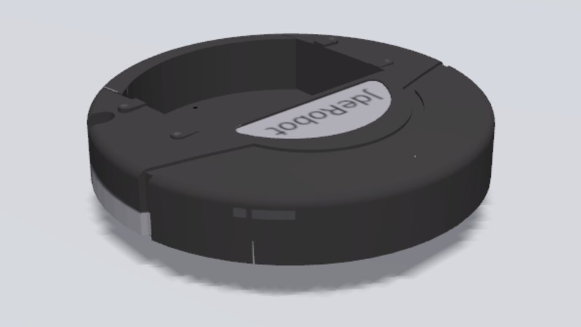 | [YouTube](https://www.youtube.com/watch?v=ceQO6Z_ZiCM) | vacuum_cleaner/launch/vacuum_cleaner.launch.py             | vacuum_cleaner           | sensor=(camera/laser)                  | camera or laser                 | differential drive              | Broken bumper in URDF              |
| TurtleBot 2        |   ok   | 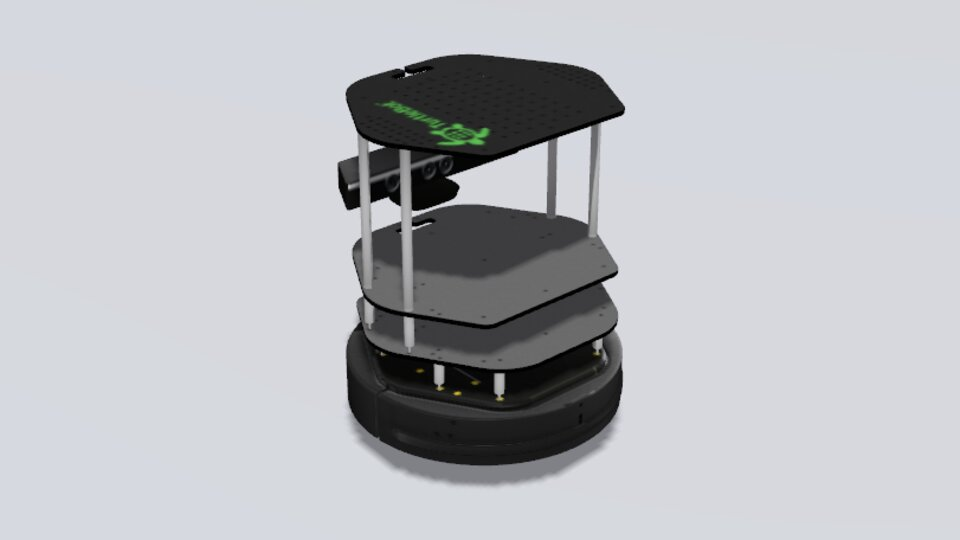 | [YouTube](https://www.youtube.com/watch?v=_5i4MkE5HxI) | Turtlebot2/launch/turtlebot2.launch.py                     | turtlebot2               | sensor=(camera/stereo)                 | camera or stereo, laser, IMU    | differential drive              |                                    |
| TurtleBot 3 Waffle |   ok   | 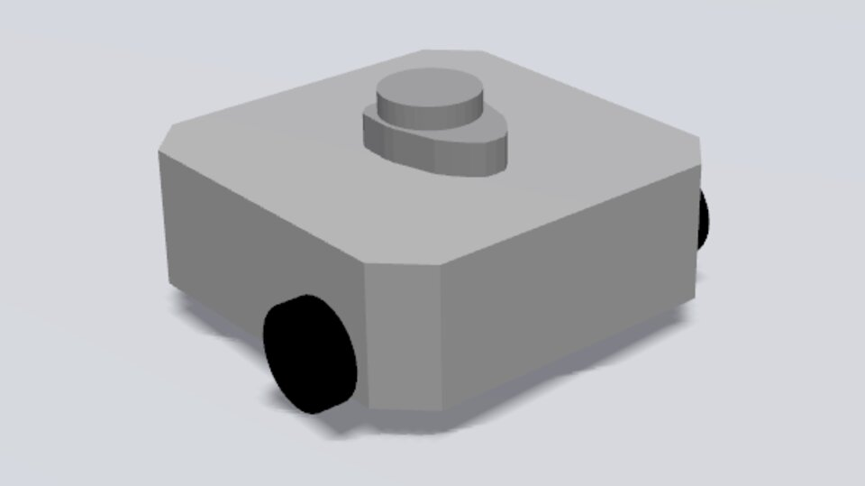 | [YouTube](https://www.youtube.com/watch?v=HF57L6ekrRg) | turtlebot3/launch/turtlebot3.launch.py                     | turtlebot3               | noise=(none/low/med/high) marker       | camera or laser, IMU            | differential drive              |                                    |
| TurtleBot 3 Burger |   ok   | 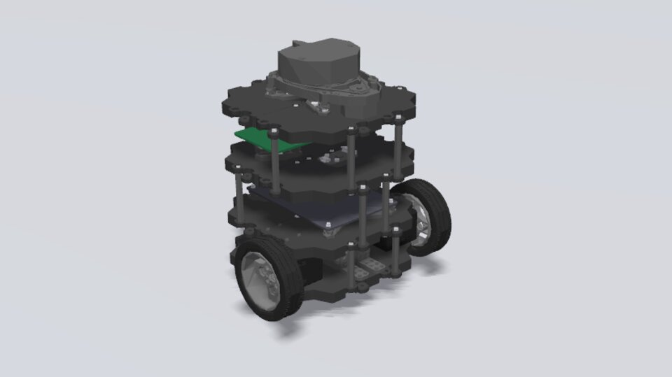 |  | turtlebot3/launch/turtlebot3_burger.launch.py              | turtlebot3               | noise=(none/low/med/high) sensor=(laser/camera) | laser, IMU, camera (optional) | differential drive    |                                    |
| Rover 4wd          |   ok   | 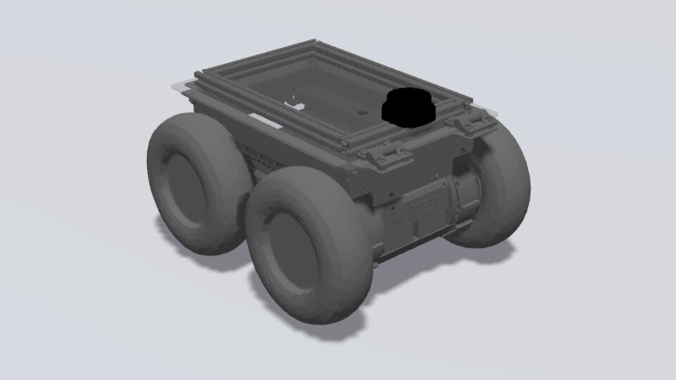 |  | rover_4wd/launch/rover_4wd.launch.py                       | rover_4wd                | noise=(none/low/high)                  | laser, IMU                      | differential drive              |                                    |
| Dingo              |   ok   | 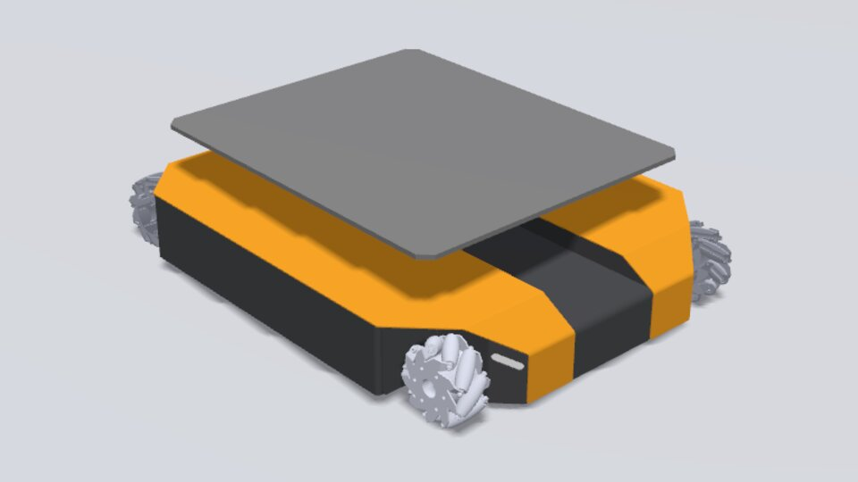 | [YouTube](https://www.youtube.com/watch?v=rH7A-gPXplU) | dingo/launch/dingo.launch.py                               | do150                    | noise=(none/low/med/high)              | laser, IMU                      | mecanum drive                   |                                    |
| MiR100             |   ok   | 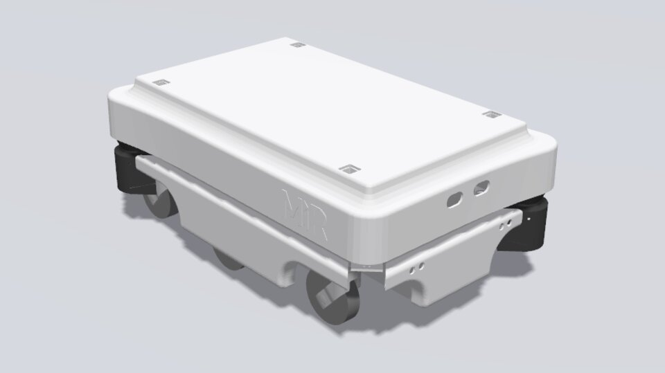 |  | mir100/launch/mir100.launch.py                             | mir100                   | noise=(none/low/med/high)              | 2x laser, IMU                   | differential drive              |                                    |
| Logistic Holonomic |   ok   |  | [YouTube](https://www.youtube.com/watch?v=t-sJ1vK8yGk) | logistic_holonomic_robot/launch/logistic_holonomic_robot.launch.py | logistic_holonomic_robot |                                | none                            | holonomic drive                 | Ball joint fails in URDF           |
| Logistic Ackermann |   ok   | 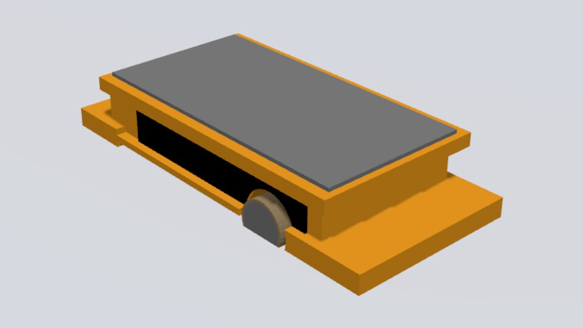 |  | logistic_ackermann_robot/launch/logistic_ackermann_robot.launch.py | logistic_ackermann_robot |                                | none                            | ackermann steering              |                                    |

### Simulated drones

| Robot     | Status | Media&nbsp;&nbsp;&nbsp;&nbsp;&nbsp;&nbsp;&nbsp;&nbsp;&nbsp;&nbsp;&nbsp;&nbsp;&nbsp;&nbsp;&nbsp;&nbsp;&nbsp;&nbsp;&nbsp;&nbsp;&nbsp;&nbsp;&nbsp;&nbsp;&nbsp;&nbsp;&nbsp;&nbsp;&nbsp;&nbsp;&nbsp;&nbsp;&nbsp;&nbsp;&nbsp;&nbsp; | Link | Launch file                          | Entity                | Configs                                  | Sensors                     | Actuators                                        | Notes |
| --------- | :----: | :---: | ---- | ------------------------------------ | --------------------- | ---------------------------------------- | --------------------------- | ------------------------------------------------ | ----- |
| Quadrotor |   ok   | 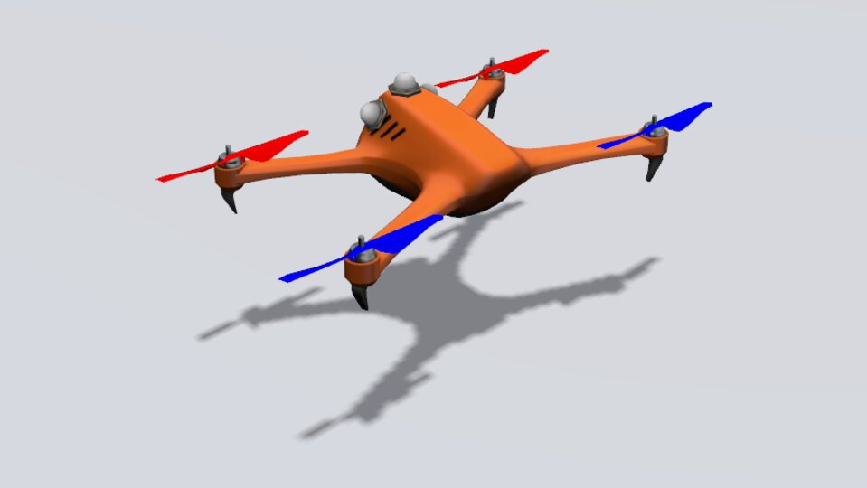 | [YouTube](https://www.youtube.com/watch?v=uNVWs_-JfV8) | quadrotor/launch/quadrotor.launch.py | drone / drone_mouse   | sensor=(camera) color gripper=(true/false) | frontal and ventral camera, IMU | multirotor (4 motors), optional magnetic gripper |       |

### Simulated robot arms

| Robot          | Status | Media&nbsp;&nbsp;&nbsp;&nbsp;&nbsp;&nbsp;&nbsp;&nbsp;&nbsp;&nbsp;&nbsp;&nbsp;&nbsp;&nbsp;&nbsp;&nbsp;&nbsp;&nbsp;&nbsp;&nbsp;&nbsp;&nbsp;&nbsp;&nbsp;&nbsp;&nbsp;&nbsp;&nbsp;&nbsp;&nbsp;&nbsp;&nbsp;&nbsp;&nbsp;&nbsp;&nbsp; | Link | Launch file                                   | Entity                 | Configs         | Sensors                | Actuators                          | Notes                    |
| -------------- | :----: | :---: | ---- | --------------------------------------------- | ---------------------- | --------------- | ---------------------- | ---------------------------------- | ------------------------ |
| UR5            |   ok   | 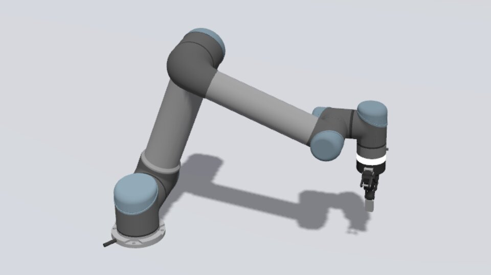 | [YouTube](https://www.youtube.com/watch?v=6AJ77qydej4) | robot_arms/launch/ur5.launch.py               | ur5_robotiq            | sensor=(camera) | camera (optional)      | 6-DOF arm + Robotiq 2F-85 gripper  | Reset broken             |
| UR3            |   ok   | 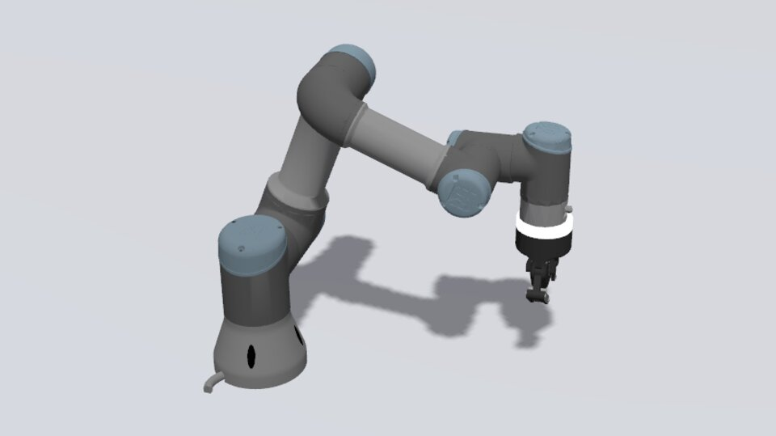 | [YouTube](https://www.youtube.com/watch?v=582AF_l46-A) | robot_arms/launch/ur3.launch.py               | ur3_robotiq            | sensor=(camera) | camera (optional)      | 6-DOF arm + Robotiq 2F-85 gripper  | MoveIt Servo variant in `ur3_servo.launch.py` |
| UR10 Suction   |   ok   | 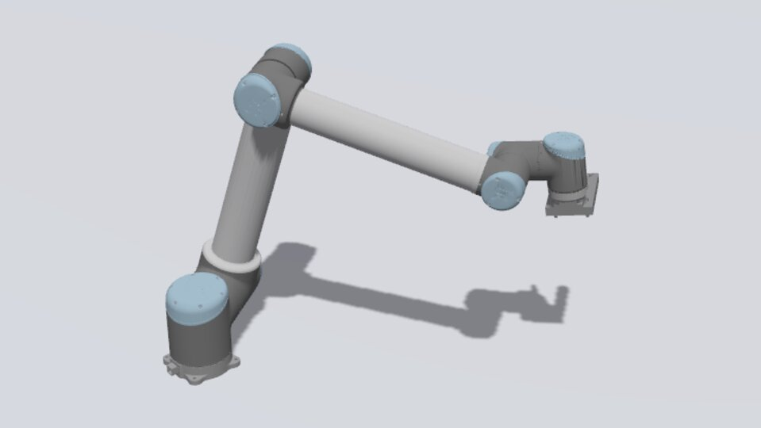 | [YouTube](https://www.youtube.com/watch?v=R9nKdS6MKUo) | robot_arms/launch/ur10_suction.launch.py      | ur10_suction           |                 | suction contact sensor | 6-DOF arm + suction gripper        |                          |
| Dobot Magician |   ok   | 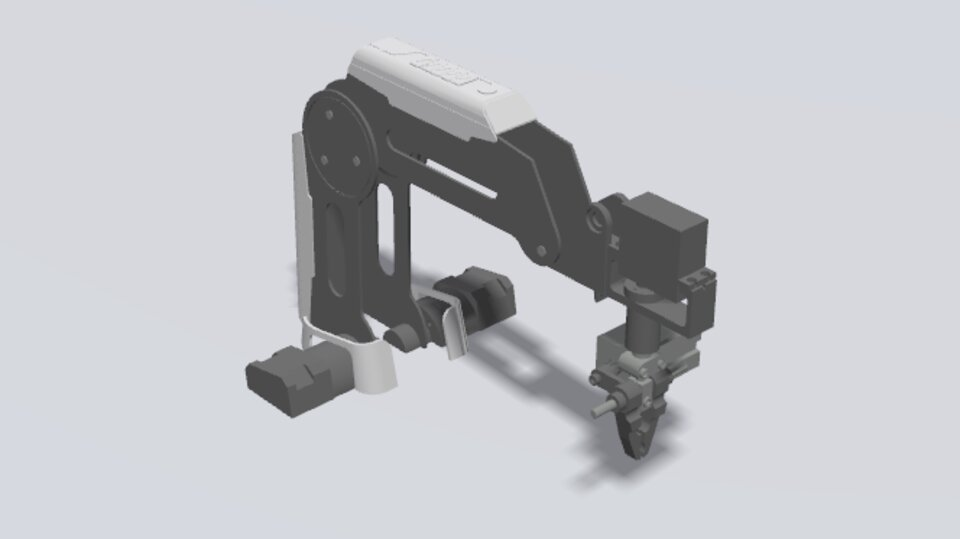 | [YouTube](https://www.youtube.com/watch?v=iZGmwDLkJz8) | robot_arms/launch/dobot_magician.launch.py    | dobot_magician_gripper | end_effector=(gripper/suction_cup) | none   | 4-DOF arm + parallel gripper or suction cup |                |

### Simulated mobile manipulators

| Robot         | Status | Media&nbsp;&nbsp;&nbsp;&nbsp;&nbsp;&nbsp;&nbsp;&nbsp;&nbsp;&nbsp;&nbsp;&nbsp;&nbsp;&nbsp;&nbsp;&nbsp;&nbsp;&nbsp;&nbsp;&nbsp;&nbsp;&nbsp;&nbsp;&nbsp;&nbsp;&nbsp;&nbsp;&nbsp;&nbsp;&nbsp;&nbsp;&nbsp;&nbsp;&nbsp;&nbsp;&nbsp; | Link | Launch file                                  | Entity        | Configs | Sensors                         | Actuators                                        | Notes                            |
| ------------- | :----: | :---: | ---- | -------------------------------------------- | ------------- | ------- | ------------------------------- | ------------------------------------------------ | -------------------------------- |
| XLeRobot      |   ok   | 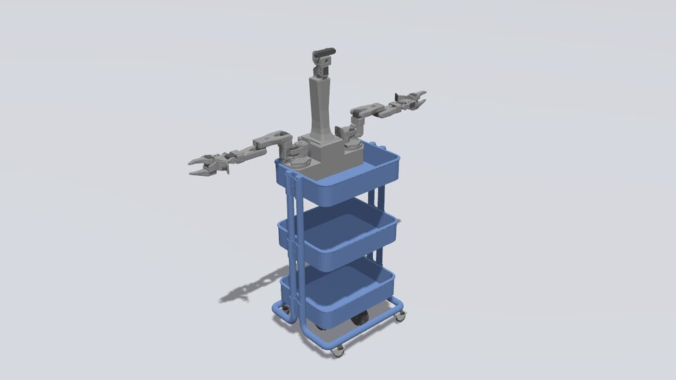 | [YouTube](https://www.youtube.com/watch?v=1XDqUomPsKM) | xlerobot/launch/xlerobot.launch.py           | xlerobot      |         | RGB-D head camera, 2x wrist camera | 3-wheel omni base + 2x 5-DOF arm with gripper | MoveIt2                          |
| MMO-500       |   ok   | 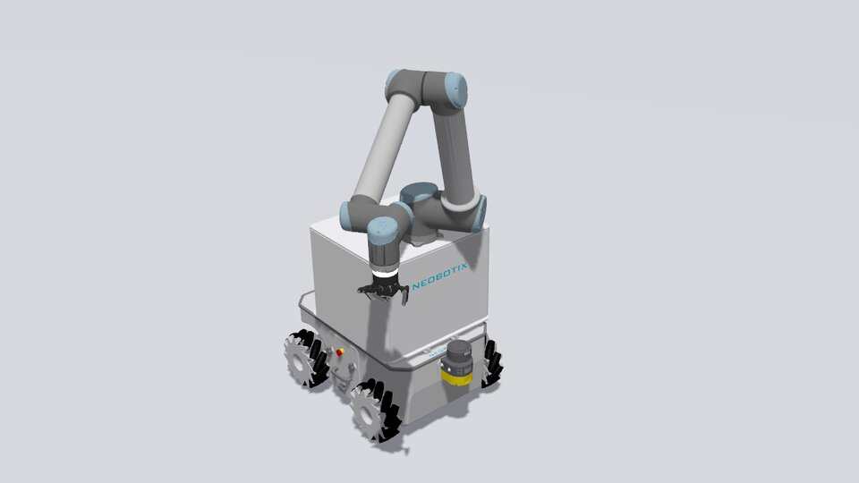 | [YouTube](https://www.youtube.com/watch?v=bsVp3GUh2f8) | mmo500/launch/mmo500.launch.py               | mmo500        | end_effector=(robotiq/harvest) | 2x laser, wrist RGB-D camera (harvest) | mecanum base + UR10 + Robotiq 2F-85 or 3-finger harvest head | MoveIt2                          |
| myAGV mechArm |   ok   | 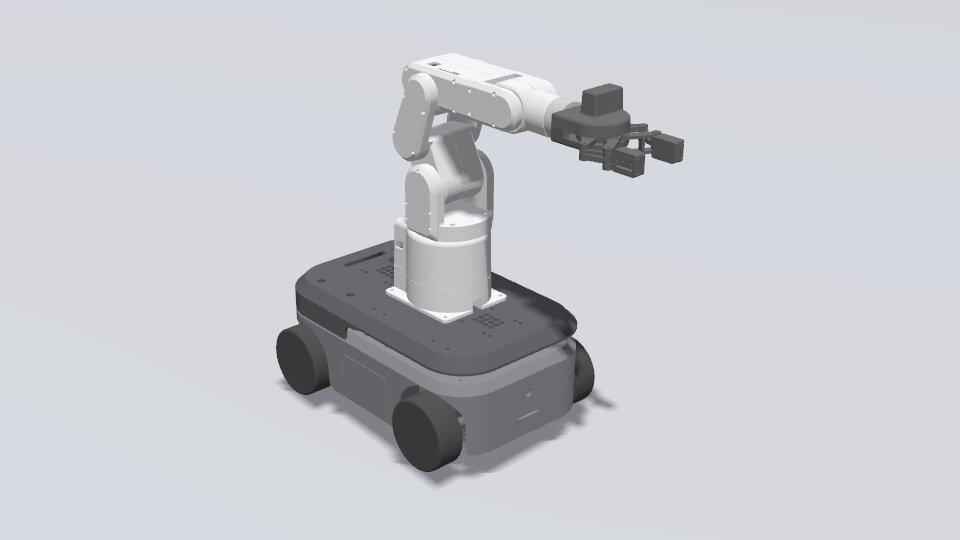 |  | myagv_mecharm/launch/myagv_mecharm.launch.py | myagv_mecharm |         | laser, camera                   | mecanum base + 6-DOF mechArm 270 + adaptive gripper | MoveIt2                          |
| myAGV myCobot |   ok   | 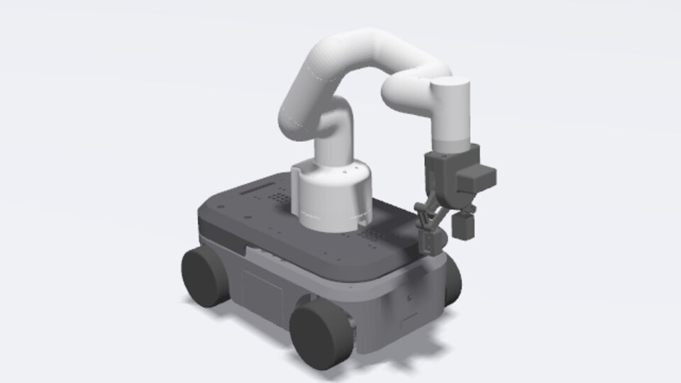 |  | myagv_mycobot/launch/myagv_mycobot.launch.py | myagv_mycobot |         | laser, camera                   | mecanum base + 6-DOF myCobot 280 + adaptive gripper | MoveIt2, not used in any scene   |

### Physical robots

The scene is of type `physical`, no simulator runs. The robot launch file brings the real robot topics into ROS2 with the same names as its simulated twin, so the same HAL works on both. Every physical scene uses `physical.launch.py`. Audio in / out is the exception, it has no robot and the WebGUI uses the browser microphone and speakers.

| Robot              | Status | Media&nbsp;&nbsp;&nbsp;&nbsp;&nbsp;&nbsp;&nbsp;&nbsp;&nbsp;&nbsp;&nbsp;&nbsp;&nbsp;&nbsp;&nbsp;&nbsp;&nbsp;&nbsp;&nbsp;&nbsp;&nbsp;&nbsp;&nbsp;&nbsp;&nbsp;&nbsp;&nbsp;&nbsp;&nbsp;&nbsp;&nbsp;&nbsp;&nbsp;&nbsp;&nbsp;&nbsp; | Link | Simulated twin     | Launch file                                          | Scene                     | Connection                                             | Notes                                              |
| ------------------ | :----: | :---: | ---- | ------------------ | ---------------------------------------------------- | ------------------------- | ------------------------------------------------------ | -------------------------------------------------- |
| UR5 / UR5e         |   ok   | 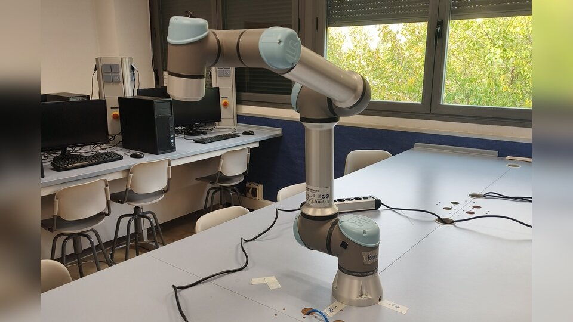 |  | UR5 | robot_arms/launch/ur5_physical.launch.py | Ur5 Physical | Ethernet (`ur_robot_driver`), ports 50001-50004 back to the PC | Tested with a UR5e in the lab, `ur5_bridge` drives the gripper |
| UR3e               |  wip   |       | [YouTube](https://www.youtube.com/watch?v=PT6SJcvSPZk) | UR3 |  |  |  | No physical launch file in RI yet, shown in the video |
| Dobot Magician     |   ok   | 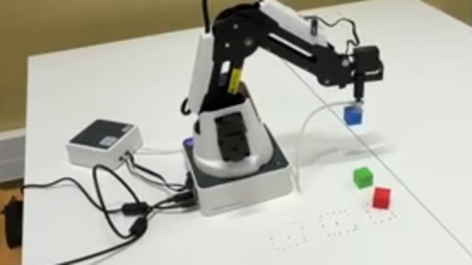 | [YouTube](https://www.youtube.com/watch?v=iZGmwDLkJz8) | Dobot Magician | robot_arms/launch/dobot_magician_physical.launch.py | Dobot Magician Physical | USB serial, host `/dev` mapped into the container | Suction cup, `dobot_magician_bridge` talks to the firmware |
| MiR100             |   ok   |       |  | MiR100             | mir100/launch/mir100_physical.launch.py              | Mir100 Physical           | rosbridge websocket to the MiR (ROS1)                  | First real test OK with image `robotics-academy:mir-beta` |
| TurtleBot 3 Burger |  wip   | 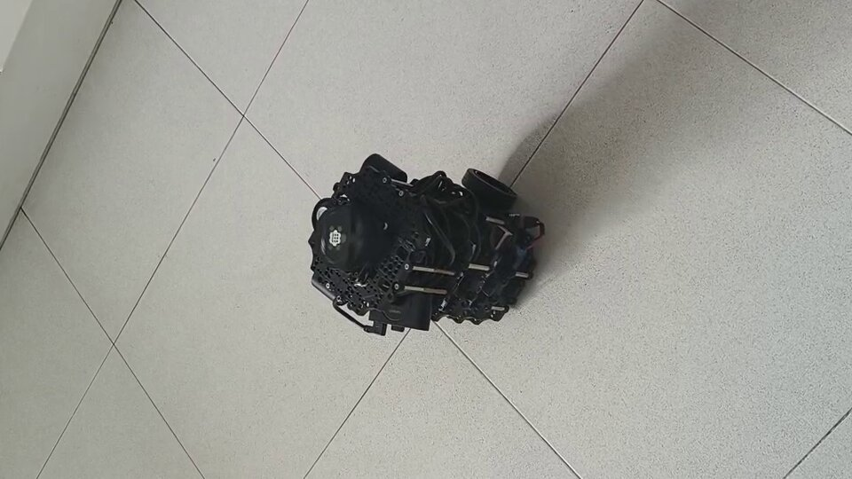 |  | TurtleBot 3 Burger | turtlebot3/launch/turtlebot3_burger_physical.launch.py | TurtleBot3 Burger Physical | Robotics Backend on the robot Raspberry Pi, WiFi      | Branch `lyrical-migration`, laser mapping tested   |
| TurtleBot 2        |  todo  |       | [YouTube](https://www.youtube.com/watch?v=-Fg9ScpHTZw) | TurtleBot 2        |                                                      |                           | USB (Kobuki base + RPLidar)                            | `Turtlebot2/Turtlebot2_physical` not wired to RAM  |
| Tello              |  todo  |       |  | Quadrotor          |                                                      |                           | WiFi                                                   | `tello_phy` driver not wired to RAM                |
| Audio in / out     |  wip   |       | [YouTube](https://www.youtube.com/watch?v=utNTaveaVEs) | Vacuum cleaner     |                                                      |                           | Browser microphone and speakers through the WebGUI     | HRI Sound exercise, branch `HRI-sound` in RA-premium |

## Scenes

Launch files live in `/opt/jderobot/Launchers`. "Robots" lists the robots the database spawns in that scene.

### Circuits and roads

| Scene               | Status | Media&nbsp;&nbsp;&nbsp;&nbsp;&nbsp;&nbsp;&nbsp;&nbsp;&nbsp;&nbsp;&nbsp;&nbsp;&nbsp;&nbsp;&nbsp;&nbsp;&nbsp;&nbsp;&nbsp;&nbsp;&nbsp;&nbsp;&nbsp;&nbsp;&nbsp;&nbsp;&nbsp;&nbsp;&nbsp;&nbsp;&nbsp;&nbsp;&nbsp;&nbsp;&nbsp;&nbsp; | Link | Launch file                   | Robots                    | Notes |
| ------------------- | :----: | :---: | ---- | ----------------------------- | ------------------------- | ----- |
| Simple Circuit      |   ok   | 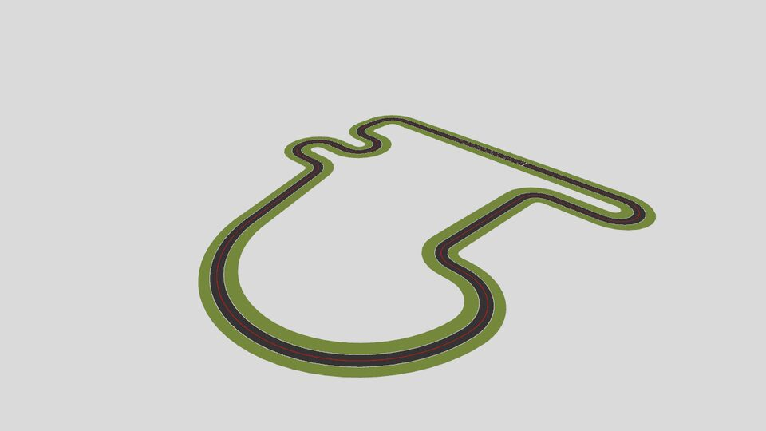 | [YouTube](https://www.youtube.com/watch?v=HRZC1-tGW-s) | simple_circuit.launch.py      | F1                        |       |
| Montmelo Circuit    |   ok   | 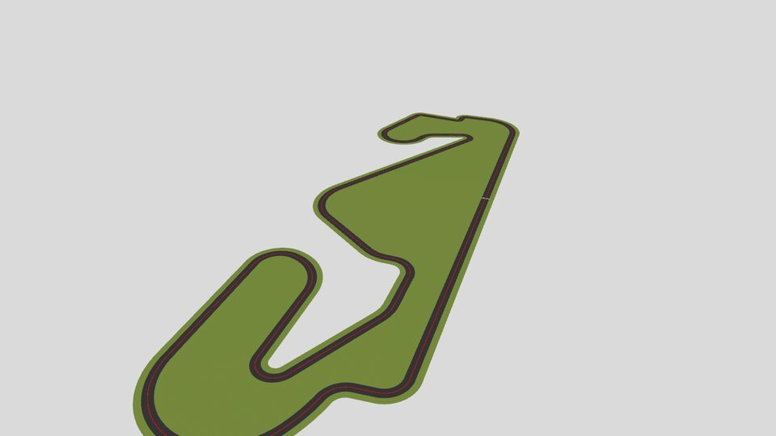 |  | montmelo_circuit.launch.py    | F1                        |       |
| Montreal Circuit    |   ok   | 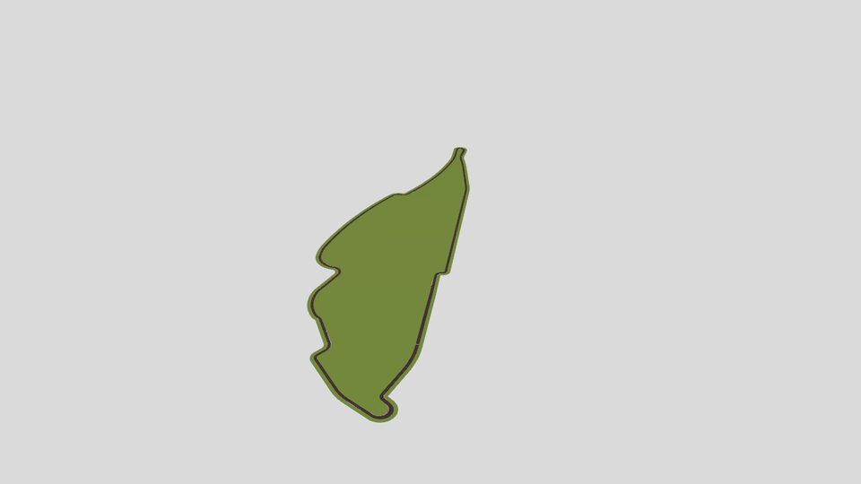 |  | montreal_circuit.launch.py    | F1                        |       |
| Nurburgring Circuit |   ok   | 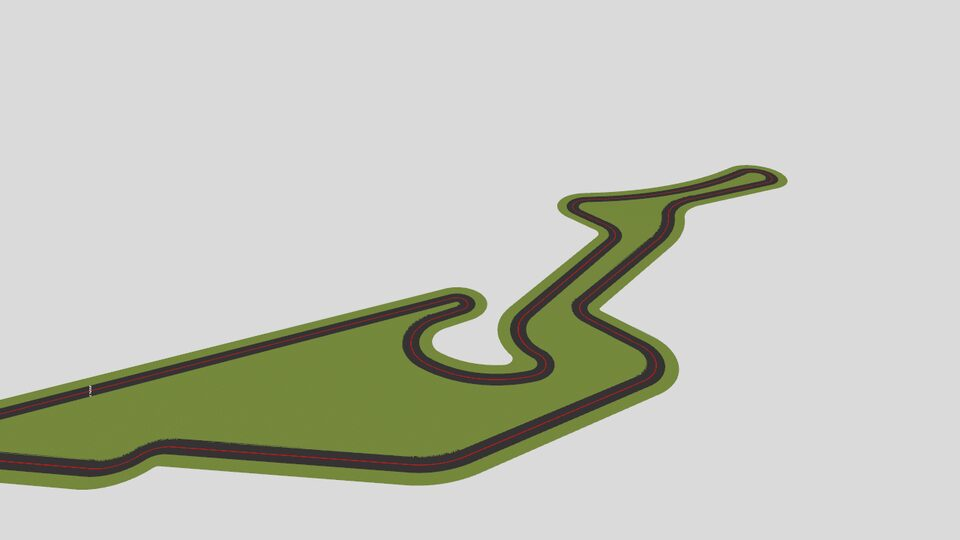 |  | nurburgring_circuit.launch.py | F1                        |       |
| Monaco Circuit      |   ok   | 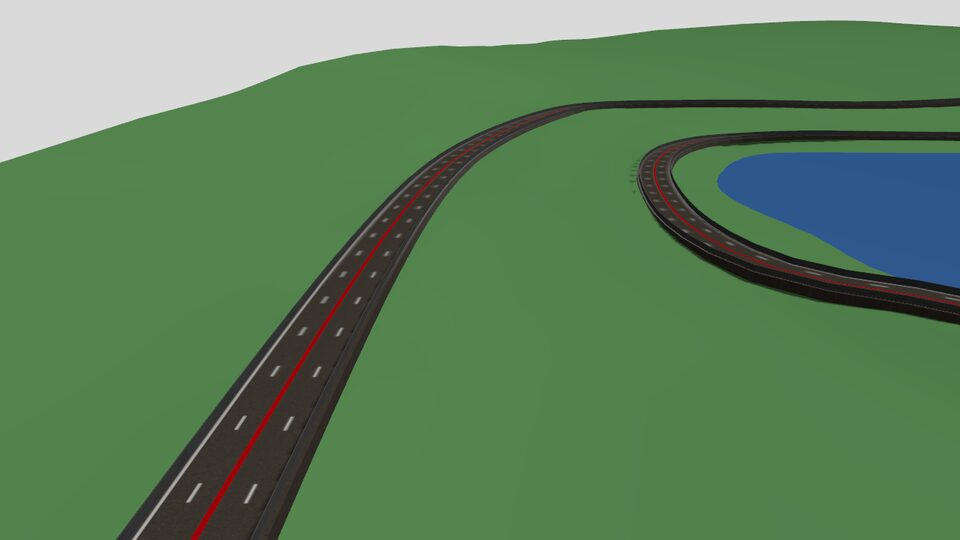 |  | monaco_circuit.launch.py      | F1                        |       |
| Spa Circuit         |   ok   | 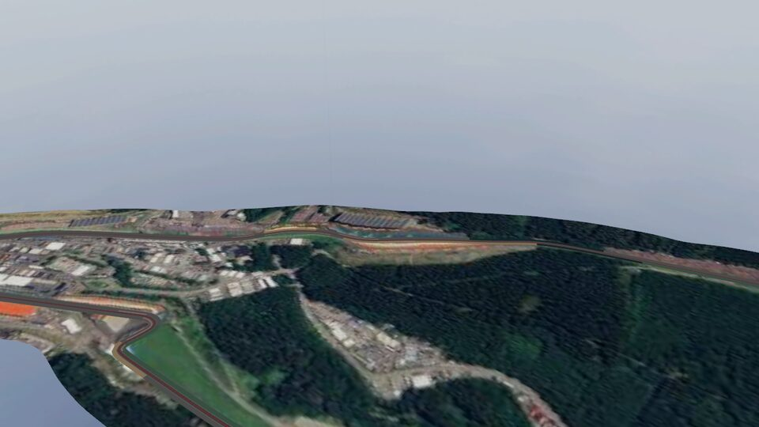 |  | spa_circuit.launch.py         | F1                        |       |
| Obstacle Avoidance  |   ok   | 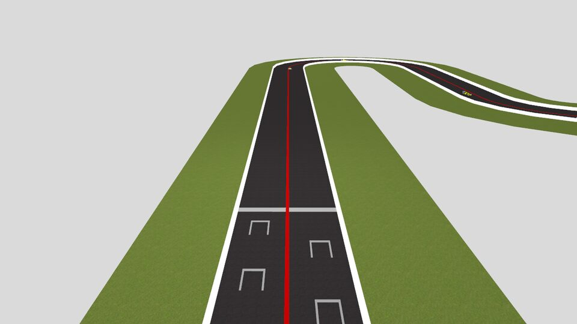 | [YouTube](https://www.youtube.com/watch?v=6JvlBnJsP90) | obstacle_avoidance_h.launch.py | F1 (laser)               |       |
| F1 Pursuit Simple Easy |   ok   | 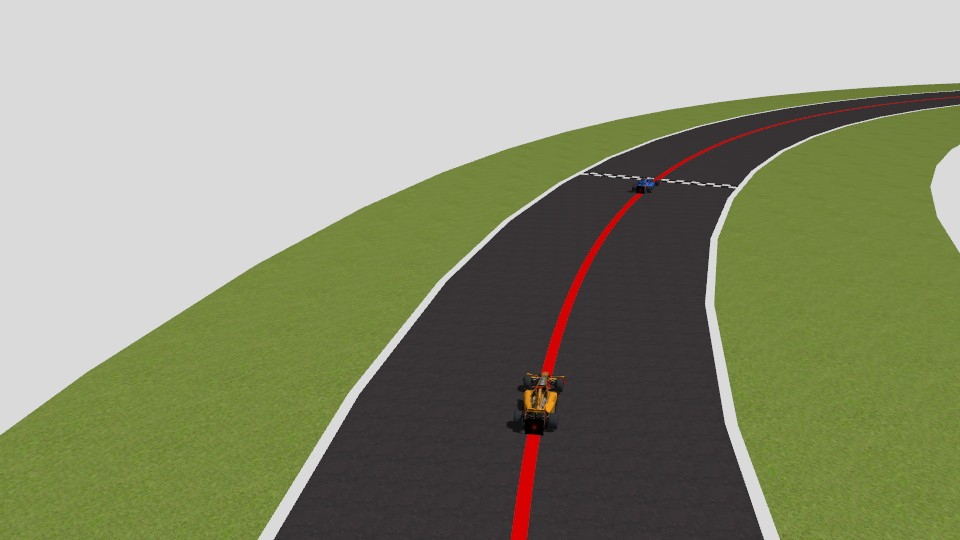 |  | f1_pursuit_simple_easy.launch.py | 2x F1                     |       |
| F1 Pursuit Simple Medium |   ok   |  |  | f1_pursuit_simple_medium.launch.py | 2x F1                     |       |
| F1 Pursuit Simple Hard |   ok   |  |  | f1_pursuit_simple_hard.launch.py | 2x F1                     |       |
| F1 Pursuit Montreal Easy |   ok   | 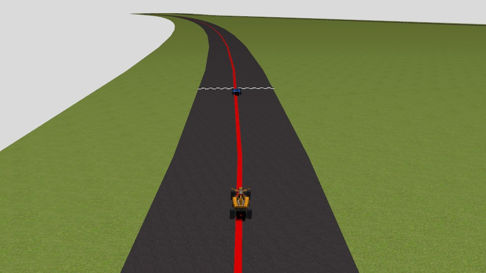 |  | f1_pursuit_montreal_easy.launch.py | 2x F1                     |       |
| F1 Pursuit Montreal Medium |   ok   |  |  | f1_pursuit_montreal_medium.launch.py | 2x F1                     |       |
| F1 Pursuit Montreal Hard |   ok   |  |  | f1_pursuit_montreal_hard.launch.py | 2x F1                     |       |
| F1 Pursuit Montmelo Easy |   ok   | 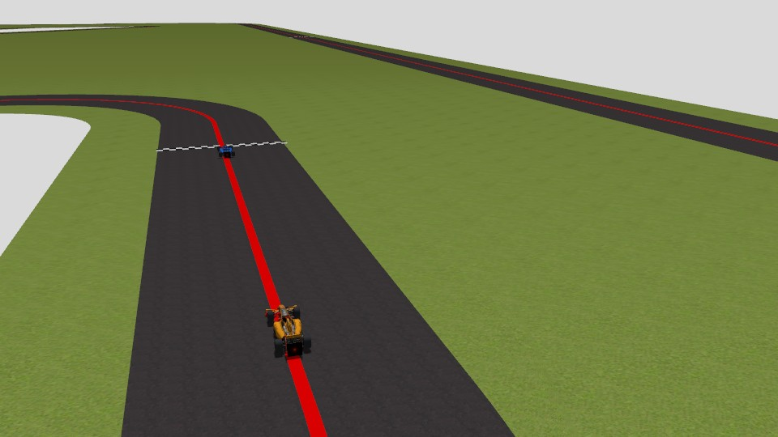 |  | f1_pursuit_montmelo_easy.launch.py | 2x F1                     |       |
| F1 Pursuit Montmelo Medium |   ok   |  |  | f1_pursuit_montmelo_medium.launch.py | 2x F1                     |       |
| F1 Pursuit Montmelo Hard |   ok   |  |  | f1_pursuit_montmelo_hard.launch.py | 2x F1                     |       |
| City Large          |   ok   | 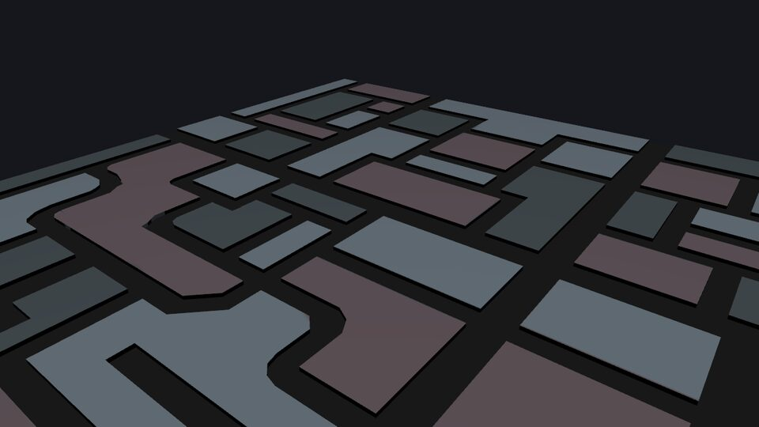 | [YouTube](https://www.youtube.com/watch?v=mOqtXiUAny0) | basic_city.launch.py          | Autonomous car            |       |
| Car Junction        |   ok   | 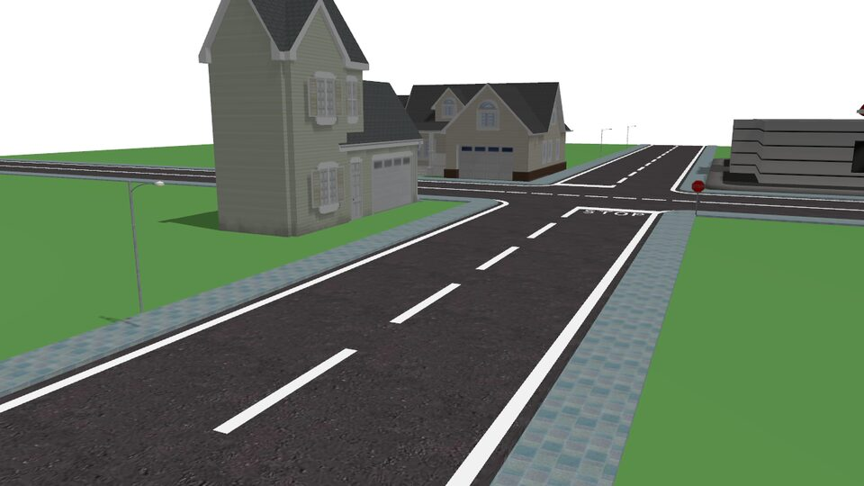 | [YouTube](https://www.youtube.com/watch?v=VBmhHapRpw4) | car_junction.launch.py        | Autonomous car            |       |
| Autopark_line       |   ok   | 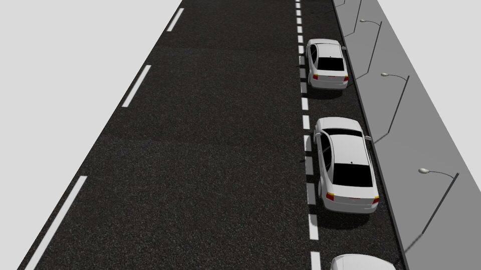 | [YouTube](https://www.youtube.com/watch?v=vQbbNEC_Dc8) | autopark_line.launch.py       | Autonomous car            |       |
| Autopark_battery    |   ok   | 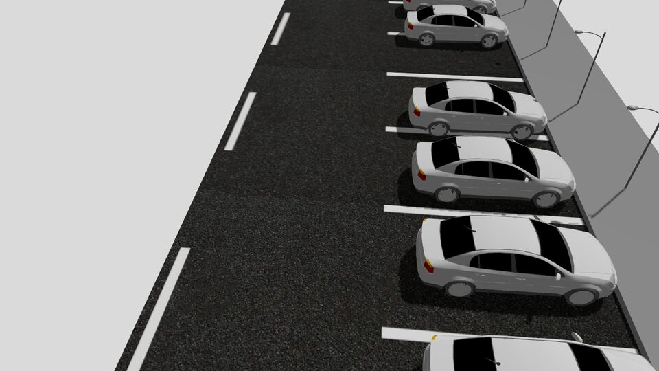 |  | autopark_battery.launch.py    | Autonomous car            |       |
| Autopark_sideways   |   ok   | 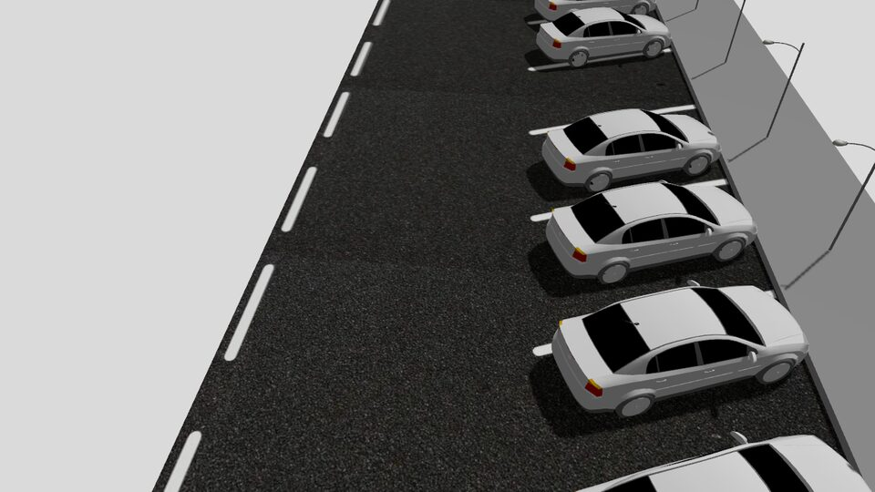 |  | autopark_sideways.launch.py   | Autonomous car            |       |
| F1 Pursuit Simple Easy     |  wip   | 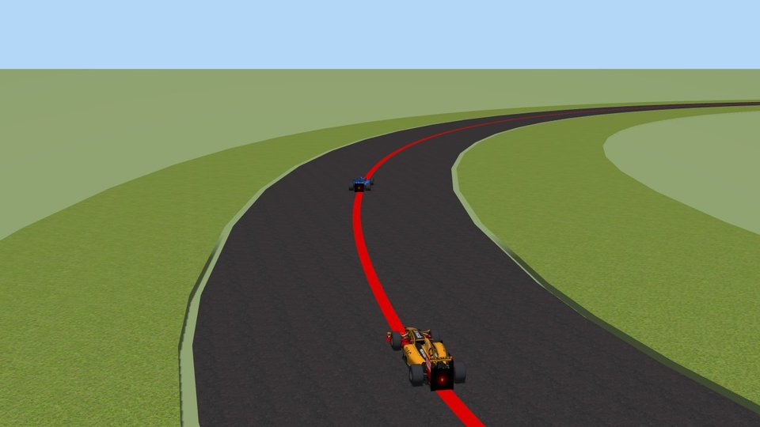 |  | f1_pursuit_simple_easy.launch.py     | 2x F1        | Branch `f1-pursuit-world` |
| F1 Pursuit Simple Medium   |  wip   |  |  | f1_pursuit_simple_medium.launch.py   | 2x F1        | Branch `f1-pursuit-world` |
| F1 Pursuit Simple Hard     |  wip   |  |  | f1_pursuit_simple_hard.launch.py     | 2x F1        | Branch `f1-pursuit-world` |
| F1 Pursuit Montreal Easy   |  wip   |  |  | f1_pursuit_montreal_easy.launch.py   | 2x F1        | Branch `f1-pursuit-world` |
| F1 Pursuit Montreal Medium |  wip   |  |  | f1_pursuit_montreal_medium.launch.py | 2x F1        | Branch `f1-pursuit-world` |
| F1 Pursuit Montreal Hard   |  wip   |  |  | f1_pursuit_montreal_hard.launch.py   | 2x F1        | Branch `f1-pursuit-world` |
| F1 Pursuit Montmelo Easy   |  wip   |  |  | f1_pursuit_montmelo_easy.launch.py   | 2x F1        | Branch `f1-pursuit-world` |
| F1 Pursuit Montmelo Medium |  wip   |  |  | f1_pursuit_montmelo_medium.launch.py | 2x F1        | Branch `f1-pursuit-world` |
| F1 Pursuit Montmelo Hard   |  wip   |  |  | f1_pursuit_montmelo_hard.launch.py   | 2x F1        | Branch `f1-pursuit-world` |
| Autoparking Gas Station: In battery  |  todo  |  |  | gas_station_battery_ackermann.launch.py | Autonomous car | Not in database |
| Autoparking Gas Station: In line     |  todo  |  |  | gas_station_line_ackermann.launch.py    | Autonomous car | Not in database |
| Autoparking Gas Station: Parking lot |  todo  |  |  | gas_station_parking_ackermann.launch.py | Autonomous car | Not in database |

### Houses and indoor

| Scene                 | Status | Media&nbsp;&nbsp;&nbsp;&nbsp;&nbsp;&nbsp;&nbsp;&nbsp;&nbsp;&nbsp;&nbsp;&nbsp;&nbsp;&nbsp;&nbsp;&nbsp;&nbsp;&nbsp;&nbsp;&nbsp;&nbsp;&nbsp;&nbsp;&nbsp;&nbsp;&nbsp;&nbsp;&nbsp;&nbsp;&nbsp;&nbsp;&nbsp;&nbsp;&nbsp;&nbsp;&nbsp; | Link | Launch file                         | Robots                          | Notes                       |
| --------------------- | :----: | :---: | ---- | ----------------------------------- | ------------------------------- | --------------------------- |
| Small House           |   ok   | 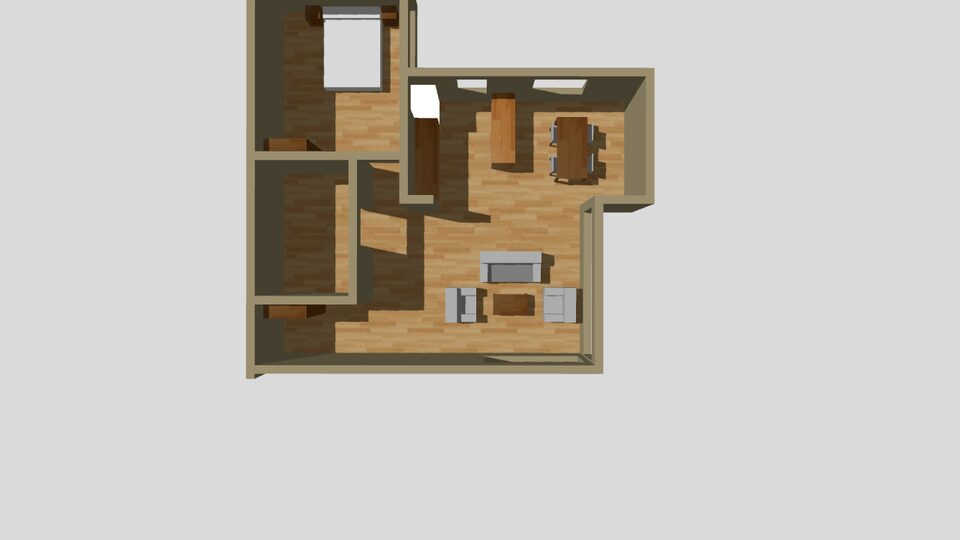 | [YouTube](https://www.youtube.com/watch?v=ceQO6Z_ZiCM) | small_house.launch.py               | Vacuum cleaner, TurtleBot 3 Burger |                          |
| Small House Roof      |   ok   | 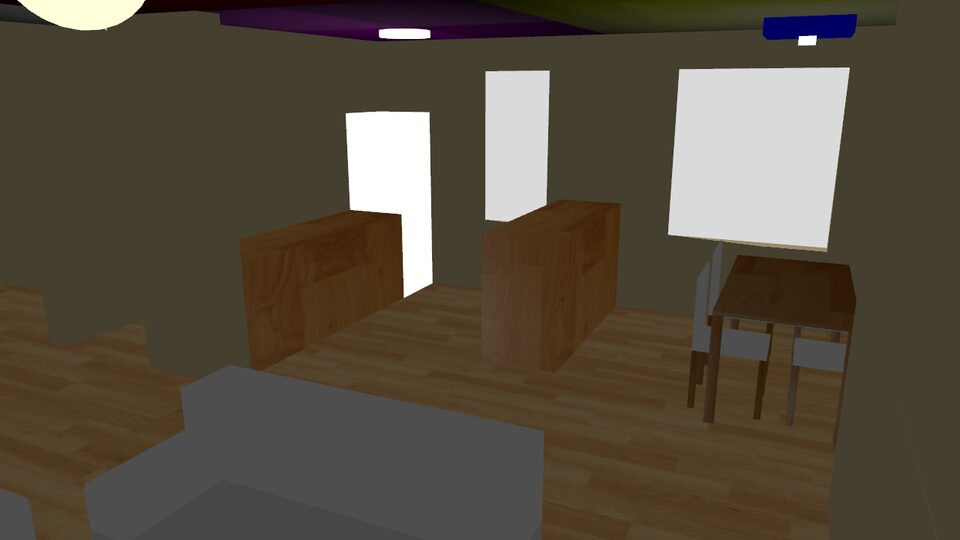 |  | small_house_roof.launch.py          | Vacuum cleaner (camera)         |                             |
| Vacuums House Markers |   ok   | 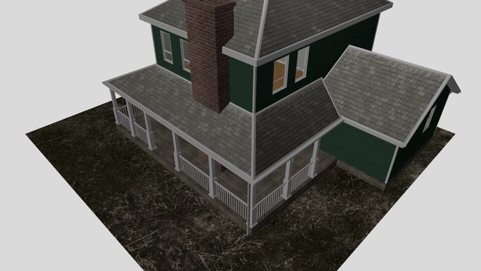 | [YouTube](https://www.youtube.com/watch?v=HF57L6ekrRg) | detailed_house.launch.py            | TurtleBot 3 Waffle, TurtleBot 3 Burger |                      |
| Vacuums Party House   |   ok   | 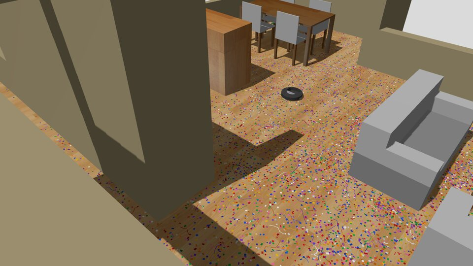 |  | vacuum_party_house.launch.py        | Vacuum cleaner                  |                             |
| Vacuums Party House with cat | ok | 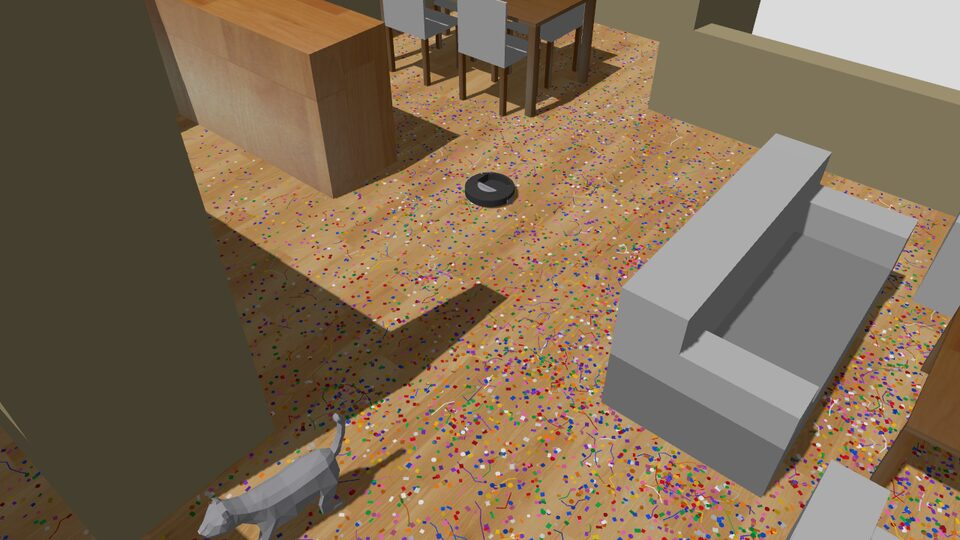 |  | vacuum_party_house_cat.launch.py | Vacuum cleaner           |                             |
| XLeRobot Home         |   ok   | 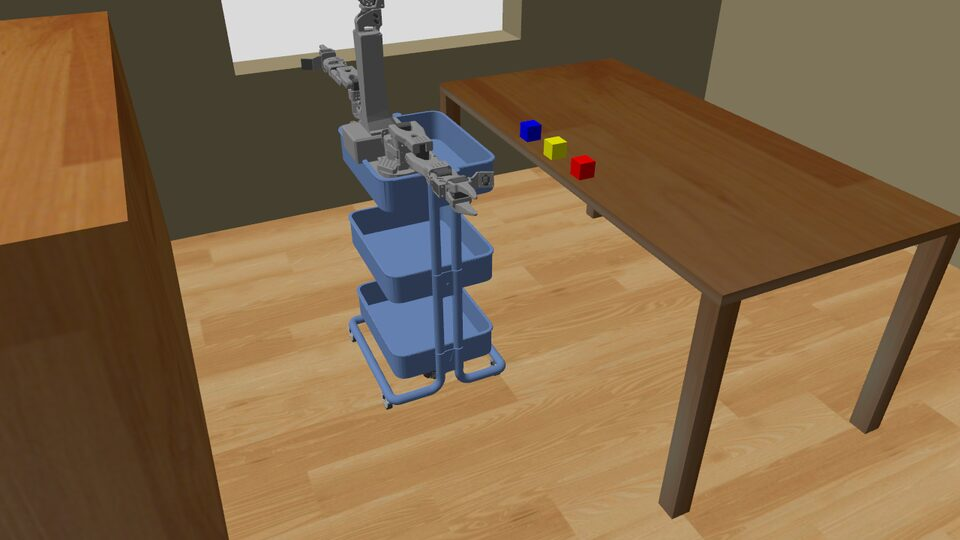 | [YouTube](https://www.youtube.com/watch?v=1XDqUomPsKM) | xlerobot_home.launch.py             | XLeRobot                        |                             |
| Follow Person         |   ok   | 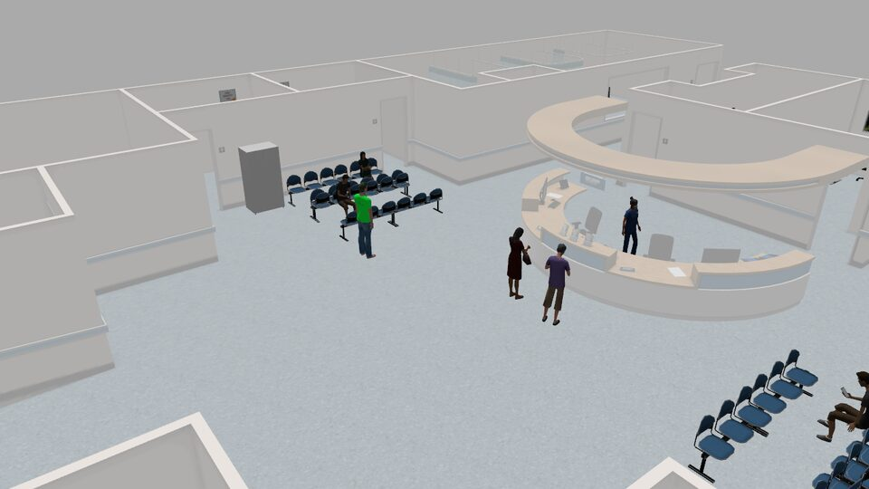 | [YouTube](https://www.youtube.com/watch?v=_5i4MkE5HxI) | follow_person_harmonic.launch.py    | TurtleBot 2                     |                             |
| Follow Person Teleop  |   ok   | 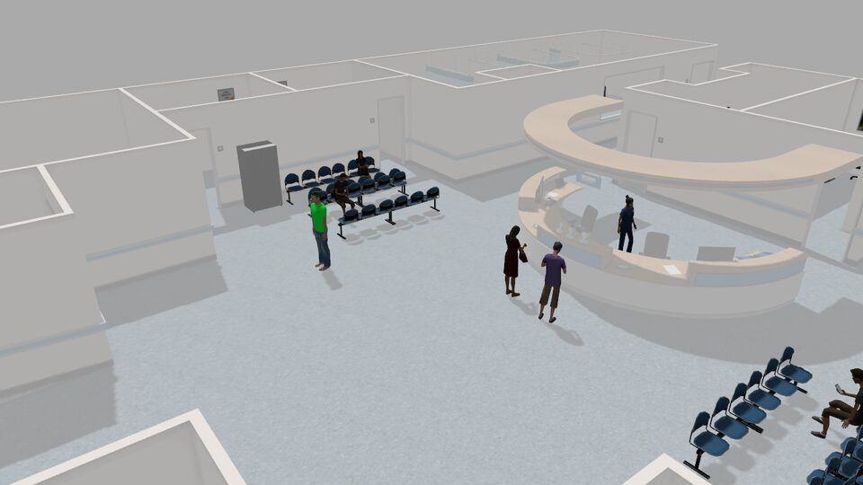 |  | follow_person_teleop_harmonic.launch.py | TurtleBot 2                 |                             |
| 3d Reconstruction     |   ok   | 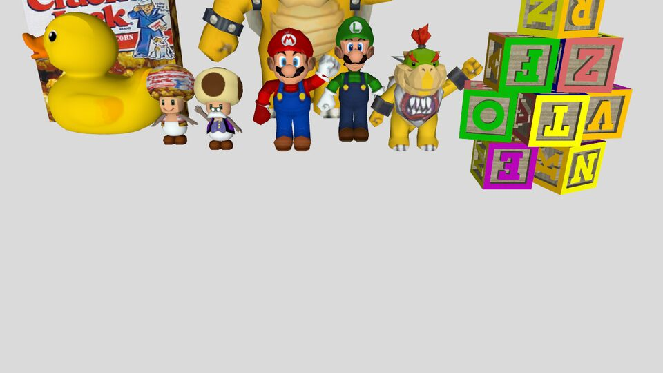 | [YouTube](https://www.youtube.com/watch?v=nJeppI5i5H0) | 3d_reconstruction.launch.py         | TurtleBot 2 (stereo)            |                             |
| UDC Grid World        |  wip   | 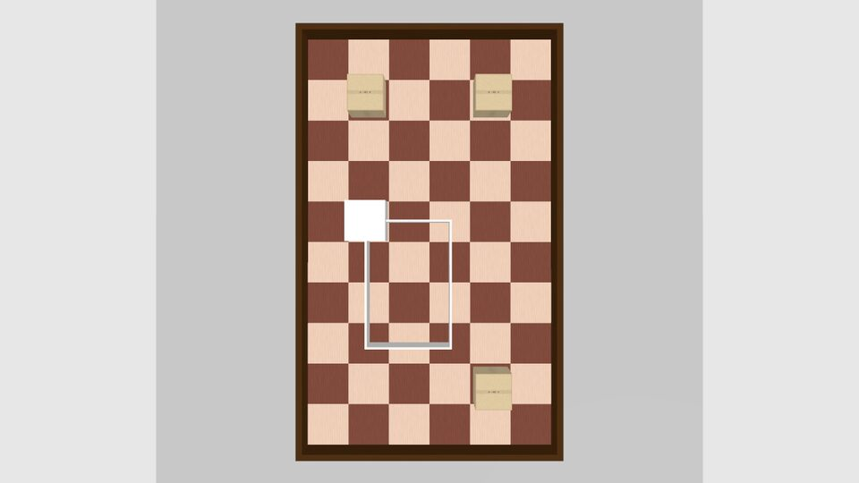 |  | udc_grid_fig3.launch.py             | TurtleBot 3 Burger              | Branch `lab-acoruna`        |
| UDC Lab Grid World    |  wip   | 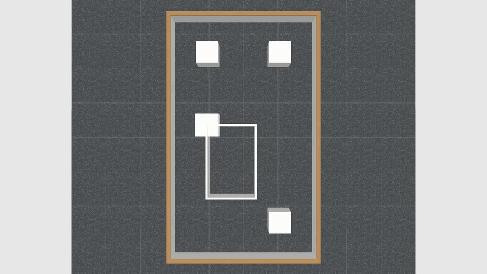 |  | udc_grid_fig3_lab.launch.py         | TurtleBot 3 Burger              | Branch `lab-acoruna`        |
| Restaurant            |  todo  |       |  | restaurant.launch.py                |                                 | Not in database        |

### Warehouses and logistics

| Scene                         | Status | Media&nbsp;&nbsp;&nbsp;&nbsp;&nbsp;&nbsp;&nbsp;&nbsp;&nbsp;&nbsp;&nbsp;&nbsp;&nbsp;&nbsp;&nbsp;&nbsp;&nbsp;&nbsp;&nbsp;&nbsp;&nbsp;&nbsp;&nbsp;&nbsp;&nbsp;&nbsp;&nbsp;&nbsp;&nbsp;&nbsp;&nbsp;&nbsp;&nbsp;&nbsp;&nbsp;&nbsp; | Link | Launch file                             | Robots                                              | Notes                                |
| ----------------------------- | :----: | :---: | ---- | --------------------------------------- | --------------------------------------------------- | ------------------------------------ |
| Warehouse 1                   |   ok   | 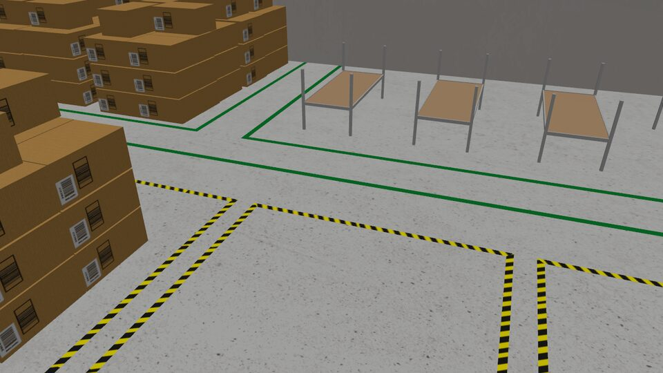 | [YouTube](https://www.youtube.com/watch?v=t-sJ1vK8yGk) | warehouse1.launch.py                    | Logistic Holonomic, Logistic Ackermann, MiR100      |                                      |
| Warehouse 1 Nav2              |   ok   |  | [YouTube](https://www.youtube.com/watch?v=-aLO-YGeaxw) | warehouse1_nav2.launch.py               | Logistic Holonomic                                  | Same world as Warehouse 1, with Nav2 |
| Warehouse 2                   |   ok   |  |  | warehouse2.launch.py                    | Logistic Holonomic, Logistic Ackermann              |                                      |
| Laser Mapping Warehouse       |   ok   |  | [YouTube](https://www.youtube.com/watch?v=rH7A-gPXplU) | laser_mapping.launch.py                 | Dingo                                               |                                      |
| Small Laser Mapping Warehouse |   ok   |  |  | small_laser_mapping.launch.py           | Dingo, TurtleBot 3 Burger                           |                                      |
| Rover 4wd Warehouse           |   ok   |  |  | rover_4wd_warehouse.launch.py           | Rover 4wd                                           |                                      |
| Mobile Manipulation Warehouse |   ok   |  | [YouTube](https://www.youtube.com/watch?v=bsVp3GUh2f8) | mobile_manipulation_warehouse.launch.py | MMO-500                                             |                                      |
| Mobile Manipulation Warehouse Nav2 | ok |  | [YouTube](https://www.youtube.com/watch?v=-aLO-YGeaxw) | mobile_manipulation_warehouse_nav2.launch.py | MMO-500                                | Same world as Mobile Manipulation Warehouse, with Nav2 |
| Warehouse Delivery            |   ok   |  |  | warehouse_delivery.launch.py            | myAGV mechArm                                       |                                      |
| XLeRobot Warehouse            |   ok   |  | [YouTube](https://www.youtube.com/watch?v=1XDqUomPsKM) | xlerobot_warehouse.launch.py            | XLeRobot                                            |                                      |

### Drones

| Scene                  | Status | Media&nbsp;&nbsp;&nbsp;&nbsp;&nbsp;&nbsp;&nbsp;&nbsp;&nbsp;&nbsp;&nbsp;&nbsp;&nbsp;&nbsp;&nbsp;&nbsp;&nbsp;&nbsp;&nbsp;&nbsp;&nbsp;&nbsp;&nbsp;&nbsp;&nbsp;&nbsp;&nbsp;&nbsp;&nbsp;&nbsp;&nbsp;&nbsp;&nbsp;&nbsp;&nbsp;&nbsp; | Link | Launch file                         | Robots                          | Notes |
| ---------------------- | :----: | :---: | ---- | ----------------------------------- | ------------------------------- | ----- |
| Rescue People          |   ok   |  |  | rescue_people.launch.py             | Quadrotor                       |       |
| Follow Road            |   ok   |  |  | follow_road.launch.py               | Quadrotor                       |       |
| Drone Gymkhana         |   ok   |  | [YouTube](https://www.youtube.com/watch?v=uNVWs_-JfV8) | drone_gymkhana.launch.py            | Quadrotor                       |       |
| Tower Inspection       |   ok   |  |  | power_tower_inspection.launch.py    | Quadrotor                       |       |
| Labyrinth Escape       |   ok   |  |  | labyrinth_escape.launch.py          | Quadrotor                       |       |
| Package delivery       |   ok   |  |  | package_delivery.launch.py          | Quadrotor (magnet)              | Magnet fails to re-grab after a reset |
| Drone Hangar           |   ok   |  |  | drone_hangar.launch.py              | Quadrotor                       |       |
| Position Control       |   ok   |  |  | position_control.launch.py          | Quadrotor                       |       |
| Drone Cat Mouse Easy   |   ok   |  | [YouTube](https://www.youtube.com/watch?v=Jj9ORzrbMdQ) | drone_cat_mouse.launch.py           | 2x Quadrotor                    |       |
| Drone Cat Mouse Medium |   ok   |  | [YouTube](https://www.youtube.com/watch?v=Jj9ORzrbMdQ) | drone_cat_mouse_medium.launch.py    | 2x Quadrotor                    |       |
| Drone Cat Mouse Hard   |   ok   |  | [YouTube](https://www.youtube.com/watch?v=Jj9ORzrbMdQ) | drone_cat_mouse_hard.launch.py      | 2x Quadrotor                    |       |
| Visual Lander          |   ok   |  |  | visual_lander.launch.py             | Quadrotor                       | Car actor has no collision |
| Visual Lander Circuit  |   ok   |  |  | visual_lander_circuit.launch.py     | Quadrotor                       | Car actor has no collision |
| Follow Turtlebot       |   ok   |  |  | follow_turtlebot.launch.py          | Quadrotor, TurtleBot 3 Waffle   |       |

### Industrial

| Scene                | Status | Media&nbsp;&nbsp;&nbsp;&nbsp;&nbsp;&nbsp;&nbsp;&nbsp;&nbsp;&nbsp;&nbsp;&nbsp;&nbsp;&nbsp;&nbsp;&nbsp;&nbsp;&nbsp;&nbsp;&nbsp;&nbsp;&nbsp;&nbsp;&nbsp;&nbsp;&nbsp;&nbsp;&nbsp;&nbsp;&nbsp;&nbsp;&nbsp;&nbsp;&nbsp;&nbsp;&nbsp; | Link | Launch file                  | Robots          | Notes                  |
| -------------------- | :----: | :---: | ---- | ---------------------------- | --------------- | ---------------------- |
| Pick And Place       |   ok   |  | [YouTube](https://www.youtube.com/watch?v=6AJ77qydej4) | pick_place.launch.py         | UR5             | Reset broken           |
| Machine Vision       |   ok   |  | [YouTube](https://www.youtube.com/watch?v=ELx35ymlQXk) | machine_vision.launch.py     | UR5 (camera)    | Reset broken           |
| Conveyor             |   ok   |  | [YouTube](https://www.youtube.com/watch?v=582AF_l46-A) | sausage_exercise.launch.py   | UR3 (camera)    |                        |
| Conveyor Servo       |   ok   |  | [YouTube](https://www.youtube.com/watch?v=582AF_l46-A) | sausage_exercise_servo.launch.py | UR3 (camera, servo) | Named `Conveyor` in the database |
| Palletizing Harmonic |   ok   |  | [YouTube](https://www.youtube.com/watch?v=R9nKdS6MKUo) | palletizing.launch.py        | UR10 Suction    |                        |
| Dobot Pick And Place |   ok   |  | [YouTube](https://www.youtube.com/watch?v=iZGmwDLkJz8) | dobot_pick_place.launch.py   | Dobot Magician  |                        |
| Dobot Suction Cup Pick And Place | ok |  | [YouTube](https://www.youtube.com/watch?v=iZGmwDLkJz8) | dobot_suction_cup_pick_place.launch.py | Dobot Magician (suction cup) |  |
| Tomato Greenhouse    |   ok   |  |  | tomato_greenhouse.launch.py      | MMO-500 (harvest) |                                  |
| Tomato Greenhouse Big |  ok   |  |  | tomato_greenhouse_big.launch.py  | MMO-500 (harvest) | Four double rows instead of two  |
| Tomato Harvest Bench |   ok   |  |  | tomato_harvest_bench.launch.py   | MMO-500 (harvest) | One plant line of the greenhouse |
| Bin Picking          |  wip   |  |  | bin_picking.launch.py            | UR5 (camera)      | Branch `bin_picking`             |
